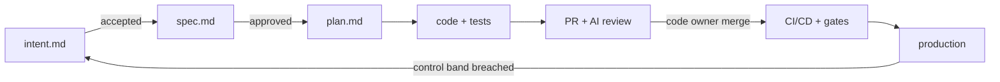

# AI-native SDLC template

A repository template for running the software development lifecycle **as a loop with Claude
embedded at every stage** — plan, design, build, test, deploy, maintain — while humans stay
accountable at explicit, enforced gates.

Each stage ends by committing an artifact that starts the next one, so the chain of commits is
also the audit trail:



> Built from the practices in Anthropic Academy's course
> [The AI-native SDLC playbook](https://academy.claude.com/courses/ai-native-sdlc-playbook/).
> This is an independent, community template — not an official Anthropic project.
> See [`doc/sdlc_guide/`](doc/sdlc_guide/README.md) for a lesson-by-lesson map to these files.

## What's inside

| Stage | Files |
|-------|-------|
| **Plan** | [`intent/`](intent/README.md) · `intent-template` skill · `/new-intent` · issue form |
| **Design** | `intent/0000-template/spec.md` · policy skills (security, compliance, brand, UX) · `/write-spec` · `intent-to-spec.yml` |
| **Build** | [`CLAUDE.md`](CLAUDE.md) · `plan.md` + `/write-plan` · [`.claude/skills/`](.claude/skills/) · [`.claude/agents/`](.claude/agents/) (verifier, code-simplifier, researcher) · build-time hooks |
| **Test** | [`Makefile`](Makefile) single-command checks · `protect-tests` + `require-verification` hooks · `/fix-bug` · [`evals/`](evals/README.md) + `agent-evals.yml` |
| **Deploy** | [`REVIEW.md`](REVIEW.md) · `CODEOWNERS` · `claude-code-review.yml` · `claude.yml` (@claude) · `/babysit-pr` · `production-gate` hook · [`managed-settings/`](managed-settings/README.md) · `ci.yml` · `deploy.yml` · `rollback-drill.yml` · [`sandbox/`](sandbox/) · `.mcp.example.json` |
| **Maintain** | [`monitoring/`](monitoring/README.md) (bands, deterministic detector, runbooks) · `metrics-monitor.yml` · [`postmortems/`](postmortems/) · `/postmortem` |
| **Governance** | [`governance/`](governance/): approval gates, environments, source of truth, policy owners, metrics |

## Getting started

Click **Use this template** on GitHub (or clone), then adopt the plays in dependency order.
Plays without prerequisites come first.

1. **Foundations** (no prerequisites)
   - [ ] Fill `CLAUDE.md` (start with `/init`, cut to one page).
   - [ ] Set `BUILD_CMD`, `TEST_CMD`, `LINT_CMD`, `RUN_CMD` in the `Makefile`; `make check` must pass.
   - [ ] Replace the placeholders in the policy skills and `governance/policy-owners.md`.
   - [ ] Review the hook lists in `.claude/hooks/*.sh` (protected paths, test layout, secret patterns).
   - [ ] Agree the gates in `governance/approval-gates.md`.
   - [ ] Capture your first idea with `/new-intent` and plan it with `/write-plan` in plan mode.
2. **Subagents and evals**
   - [ ] Adapt `.claude/agents/`.
   - [ ] Write 20–50 evals from real tasks in `evals/` and set them `enabled`.
3. **Requirements and review**
   - [ ] Fill `REVIEW.md` and `.github/CODEOWNERS`; turn on branch protection with required code-owner review.
   - [ ] Add the `ANTHROPIC_API_KEY` secret and set the repository variable **`SDLC_ENABLED=true`** to activate the Claude workflows.
4. **CI/CD**
   - [ ] Implement `scripts/deploy.sh` and `scripts/rollback.sh`; create the `dev`, `staging`, `production` environments (production with required reviewers).
   - [ ] Configure deploy MCP servers from `.mcp.example.json`; run agent jobs in `sandbox/`.
5. **Closing the loop**
   - [ ] Pick one metric in `monitoring/bands.yaml`, verify its source, and let `metrics-monitor.yml` run.
   - [ ] For regulated setups, roll out `managed-settings/` through MDM or the admin console (note it disables project hooks: move the gates into it).

Until `SDLC_ENABLED` is set, only **Template check** runs (scaffold validation + detector tests).

## Local checks
```bash
make validate-template   # JSON/YAML/shell syntax, frontmatter, hook wiring, runbook refs
make monitor-test        # unit tests for the control-band detector
```
Hooks run under bash; on Windows use Git Bash. They use `jq` when present and fall back to Python.

## Principles
- **Every stage commits an artifact**; the next stage reads it. Git is the audit trail.
- **Skills advise, hooks enforce.** Policies that must always hold get a deterministic control.
- **Claude never approves its own work.** Code owners approve; production needs a named human.
- **Verification is part of "done".** Claude runs the checks and pastes the evidence.
- **Measure each play** with one leading and one lagging indicator (`governance/metrics.md`).

## License
[MIT](LICENSE)
