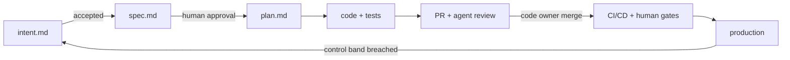

# AI-native SDLC template

A **harness-independent** repository template for plan → design → build → test → deploy →
maintain. Humans stay accountable at explicit review and production gates. Claude Code and
Codex have native adapters; any other CLI/SDK can integrate through a versioned JSON contract.

**Start your own project:** use GitHub's **Use this template**. **Improve this template:** fork
it and open a PR. See the [adoption guide](docs/adoption.md), [guía en español](docs/adoption.es.md),
and [instructions for agents](AGENTS.md). If the template button is absent, the owner can
enable Settings → General → Template repository; a fork is a usable alternative.



> Inspired by Anthropic Academy's [AI-native SDLC playbook](https://academy.claude.com/courses/ai-native-sdlc-playbook/).
> This independent community template applies those practices across harnesses and providers.
> The [lesson map](doc/sdlc_guide/README.md) preserves the original attribution.

## One shared core, optional adapters

| Component | Source of truth |
|-----------|-----------------|
| Instructions for every agent | [AGENTS.md](AGENTS.md) |
| Policy skills, task procedures, roles | [.agents/](.agents/README.md) |
| Deterministic policy events and decisions | `.agents/hooks/`, `scripts/policy.py` |
| Noninteractive execution and normalized results | `scripts/agent_run.py`; select `claude`, `codex`, or `command` |
| Claude discovery and native hook translation | Generated `CLAUDE.md`/`.claude/`, `scripts/claude_hook.py` |
| Verification and evals | [Makefile](Makefile), [evals/](evals/README.md) |
| Reviews, approval gates, policy owners | [REVIEW.md](REVIEW.md), CODEOWNERS, [governance/](governance/approval-gates.md) |
| Delivery and maintenance | `.github/workflows/`, [sandbox/](sandbox/), [monitoring/](monitoring/README.md), postmortems/ |

Hermes, Muse, Dots, Grok and other harnesses can consume the same Markdown and implement the
command adapter. They do not need Claude's slash commands or subagent system. The
[contract and compatibility matrix](.agents/README.md) explain actual support and limits:
instructions and declared capabilities do not replace an enforced sandbox.

## Quick start

Install Python 3.12, Bash, Git, Make and ShellCheck, then from your new repository:

```bash
python3 -m venv .venv
source .venv/bin/activate
python3 -m pip install 'PyYAML==6.0.3'
make doctor
make template-check
```

No model account or API key is needed for these checks. They validate JSON/YAML/shell
syntax, policy/adapter behavior, generated-file drift and detector logic. The template has
no application yet: `make build`, `make test`, `make lint` and `make run` intentionally fail
until the project's `*_CMD` values are configured. Do not turn placeholders into empty passes.

For an agent task, install and authenticate your selected harness and write a prompt file:

```bash
export SDLC_AGENT_ADAPTER=codex  # or claude; command for another CLI/SDK
python3 scripts/agent_run.py --prompt-file out/task.md --mode read-only --output out/result.json --text
```

The [adoption guide](docs/adoption.md) covers pinned CLI installation, credentials, command
adapters, first tasks and GitHub settings. An agent discovering this repo should read
[AGENTS.md](AGENTS.md) and the guide before adapting an existing project.

## Adopt the SDLC loop

1. Customize AGENTS.md, the application Make commands, policy skills, named owners and approval gates.
2. Capture the first idea under `intent/NNNN-slug/`; follow `.agents/commands` for spec, plan and implementation.
3. Choose an adapter, test its permissions and add real enabled evals. `make evals` uses the same runner;
   zero cases is SKIPPED, and `bash evals/run.sh --require-enabled` fails until cases exist.
4. Configure GitHub variables/selected credentials, CODEOWNERS, branch protection and deployment environments.
   Set SDLC_ENABLED=true only after adopting the project. Shared workflows call the common runner;
   legacy @claude action workflows are opt-in via SDLC_CLAUDE_ACTION_ENABLED=true.
5. Implement deployment/rollback, verify one real monitoring source and rehearse the production gates.

Edit canonical files and run `make sync-adapters`. CI rejects generated adapter drift.
Existing users should follow the [migration guide](docs/migration.md) before regenerating
custom Claude files. `managed-settings/` remains a **Claude-specific example**; apply the
corresponding native or external enforcement for your harness.

## Principles

- Each stage commits an artifact; Git preserves the audit trail.
- Skills advise; sandboxes, deterministic controls, CI and human review enforce boundaries.
- Agents never approve their own work. Code owners approve; production needs a named human.
- Verification reports actual passes, failures, disabled and unrun checks.
- Measure each play with a leading and a lagging indicator in governance/metrics.md.

[MIT](LICENSE)
